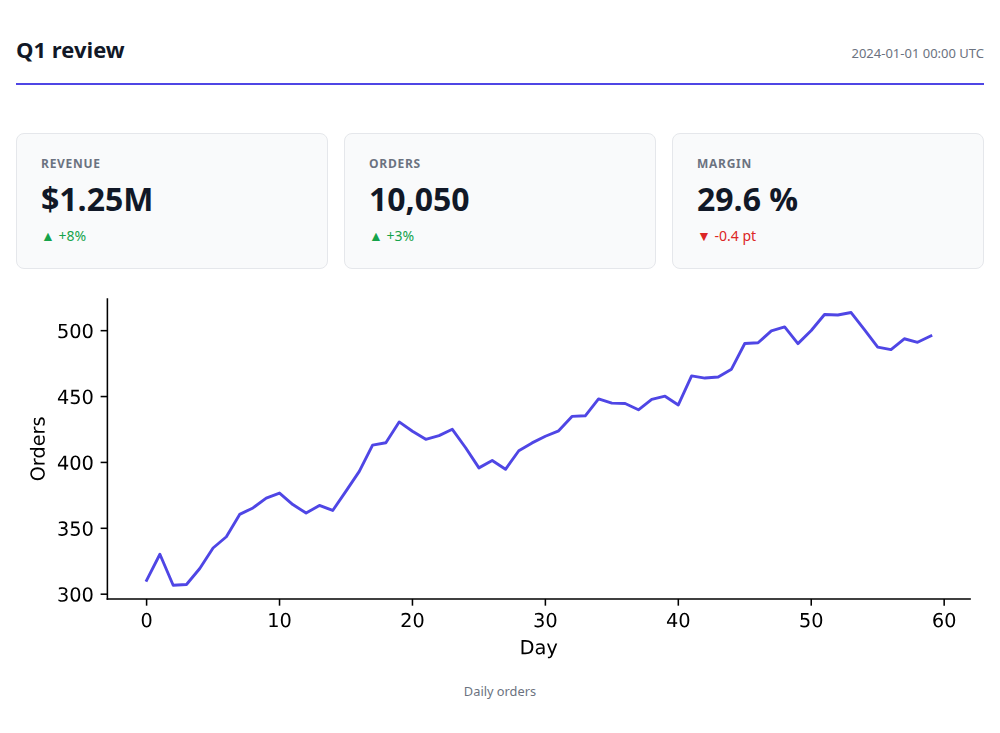

# briefing

[](https://briefing.readthedocs.io)
[](https://pypi.org/project/briefing/)

Build beautiful, self-contained reports from Python, authored by a person, a coding agent, or both.

A report is a short list of blocks (`Text`, `BigNumber`, `Plot`, `DataTable`, `Group`, `Select`, …),
saved as **one HTML file** with every script, style and image inside it: no CDN, no server, no
account. It opens offline, forever, and prints, or exports to PNG and PDF, cleanly.



## Why briefing exists

Three things led me here:

- **Coding agents are good at making something to show you, not at making it consistently.** A few months of building with coding agents surfaced the same gap every time: they're happy to produce an artifact, but each one comes out with its own structure, and nothing tracks how a piece of content evolved across a project. There was no shared grammar a person and an agent could both build reports from as the report generation was opaque.
- **[datapane](https://github.com/datapane/datapane) was the cleanest report builder I'd used.** Block-based, self-contained HTML output, a dead-simple API. I relied on it constantly to turn Python analysis into reports for stakeholders and to monitor pipelines. It was decommissioned in 2023 when the SaaS behind it shut down, and nothing since has replaced it.
- **No visualization tool covers everything, and the ones that push furthest often don't stick around.** Years of building visualizations taught me that every tool, however good, eventually falls short of the next thing you want to show. The niche packages that *do* push past that, like [Facets](https://github.com/PAIR-code/facets) (PAIR / Google) and its Facets Dive explorer, bring real value but rarely stay maintained. I wanted a place of my own to keep building and sharing that kind of custom, interactive visualization, without depending on someone else's side project staying alive.

briefing is built to close all three gaps at once: a block grammar solid enough for me *and* my coding agents to build reports from consistently, with datapane's simplicity and a home for the custom, interactive visualization that inspired it. All of it self-contained, offline, with no cloud account required.

## Install

```bash
pip install briefing                 # the block grammar and the HTML renderer
pip install "briefing[pandas]"       # tables from dataframes
pip install "briefing[lab]"          # DataProfile, DataDive, CalendarHeatmap
pip install "briefing[image]"        # save_image / save_pdf (then: playwright install chromium)
```

The core has no plotting or dataframe dependency. `Plot` takes a Plotly, Altair, Matplotlib or
Bokeh figure and imports only the library you pass; install `[plotly]`, `[altair]`, `[bokeh]`,
`[matplotlib]` or all of them with `[charts]`. Python 3.11+, pandas 2 and 3; polars and pyarrow
tables are converted for you.

## Quick start

```python
import briefing as bf

report = bf.Briefing(
    bf.Text("# Sales Analysis, Q1 2024"),
    bf.Group(
        bf.BigNumber("Revenue", "$4.2M", change="-12%", is_upward_change=False),
        bf.BigNumber("Active Users", "142K", change="+3%", is_upward_change=True),
        columns=2,
    ),
    bf.Select(
        bf.Plot(fig, label="Trend"),
        bf.DataTable(df, label="Raw Data"),
        bf.lab.DataProfile(df, label="Profile"),
    ),
)

bf.save(report, "q1_analysis.html", name="Sales, Q1 2024")
```

Here `df` is a dataframe and `fig` a chart from any supported library. In a notebook, any block
previews itself as the last expression of a cell.

With `briefing[image]`, `bf.save_image(report, "q1.png", size="og")` renders a 1200×630 social
card and `bf.save_pdf(report, "q1.pdf")` a PDF of every page, both offline in headless Chromium.

## Documentation

**[briefing.readthedocs.io](https://briefing.readthedocs.io)** has a guide for each block family
with live examples, themes, notebooks, printing and export, the `briefing.lab` blocks, recipes and
the full API reference.

- [Changelog](CHANGELOG.md)
- [`examples/notebook_walkthrough.ipynb`](examples/notebook_walkthrough.ipynb): build a report
  cell by cell, then save it ([the report it saves](examples/sales_report.html))
- [Issues](https://github.com/jeanmidevacc/briefing/issues): bugs, ideas and the roadmap
