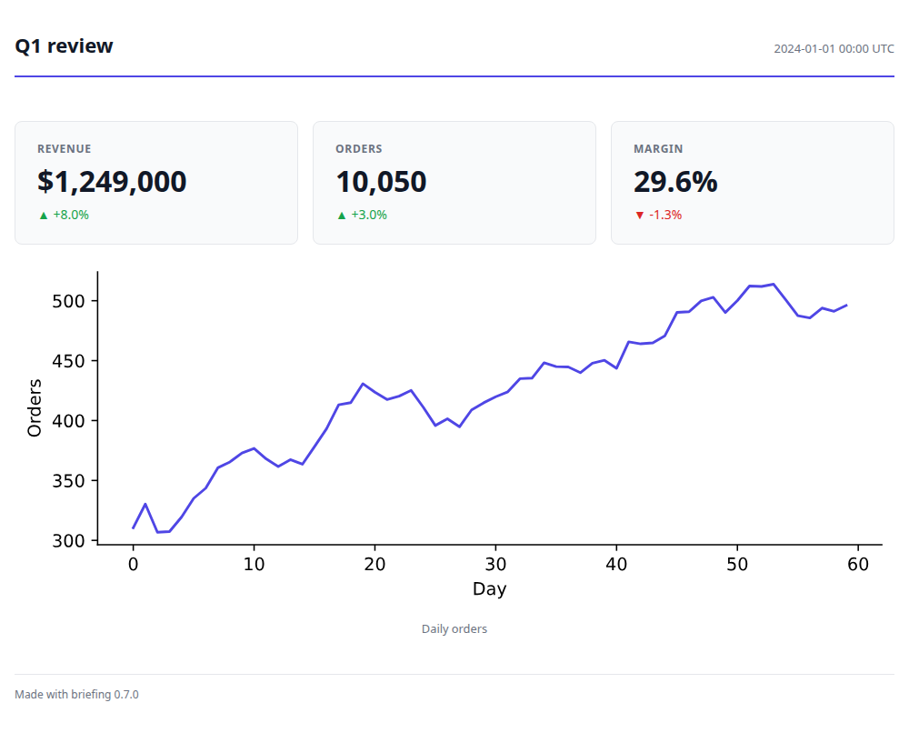

# briefing

[](https://briefing.readthedocs.io)
[](https://pypi.org/project/briefing/)

A Python framework for self-contained reports, slide decks and email digests, written by a
person, a coding agent, or both together.

Everything is built from one short grammar of blocks (`Text`, `BigNumber`, `Plot`, `DataTable`,
`Group`, `Select`, …) and saved as **one HTML file** with every script, style and image inside
it: no CDN, no server, no account. It opens offline, forever, and prints or exports to PNG and
PDF cleanly.



## Why briefing exists

Three things led me here:

- **Coding agents are good at making something to show you, not at making it consistently.**
  A few months of building with coding agents surfaced the same gap every time: they're happy
  to produce an artifact, but each one comes out with its own structure, and nothing tracks how
  a piece of content evolved across a project. There was no shared grammar that a person and an
  agent could both build reports from, and how a report came to be stayed opaque.
- **[datapane](https://github.com/datapane/datapane) was the cleanest report builder I'd used.**
  Block-based, self-contained HTML output, a dead-simple API. I relied on it constantly to turn
  Python analysis into reports for stakeholders and to monitor pipelines. It was decommissioned
  in 2023 when the SaaS behind it shut down, and nothing since has replaced it. briefing is its
  spiritual successor, with a few new turns.
- **No visualization tool covers everything, and the ones that push furthest often don't stick
  around.** Years of building visualizations taught me that every tool, however good, eventually
  falls short of the next thing you want to show. The niche packages that *do* push past that,
  like [Facets](https://github.com/PAIR-code/facets) (PAIR / Google) and its Facets Dive
  explorer, bring real value but rarely stay maintained. I wanted a place of my own to keep
  building and sharing that kind of custom, interactive visualization, without depending on
  someone else's side project staying alive.

briefing is built to close all three gaps at once: a block grammar solid enough for me *and* my
coding agents to build reports from consistently, with datapane's simplicity and a home for the
custom, interactive visualization that inspired it. All of it self-contained, offline, with no
cloud account required.

## One grammar, three outputs

|  | Report | Slide deck | Email digest |
| --- | --- | --- | --- |
| **For** | Exploring and reference | Presenting, or sending round as a PDF | A short summary in the inbox |
| **Holds** | Every block: pages, tabs, links | Every block, one slide at a time | Text, numbers, alerts, charts as images, short tables |
| **Interactive** | Yes | Yes in the browser, as it shows in a PDF | No: mail apps run no script |
| **Made with** | `bf.Briefing` → `bf.save` | `bf.deck.Deck` → `bf.deck.save` | `bf.email.Digest` → `bf.email.to_message` |

## Install

```bash
pip install briefing                 # every block (lab included): reports, decks, email digests
pip install "briefing[altair]"       # Altair charts: the Vega runtime they embed
pip install "briefing[pillow]"       # lighter images: resize and re-encode them on the way in
pip install "briefing[image]"        # PNG and PDF exports (then, once: playwright install chromium)
```

briefing installs pandas, for tables, but no chart library: `Plot` takes a Plotly, Altair,
Matplotlib or Bokeh figure and imports only the library you pass, which you already have.
Python 3.11+, pandas 2 and 3; polars and pyarrow tables are converted for you.

## Quick start

A report:

```python
import briefing as bf

report = bf.Briefing(
    bf.Text("# Sales, Q1 2026"),
    bf.Group(
        bf.BigNumber("Revenue", 4.2e6, prev_value=4.8e6, format="${:,.0f}"),  # ▼ -12.5%, in red
        bf.BigNumber("Margin", 0.31, prev_value=0.29, format="{:.0%}"),
        columns=2,
    ),
    bf.Select(
        bf.Plot(fig, label="Trend"),
        bf.DataTable(df, label="Rows"),
        bf.lab.DataProfile(df, label="Profile"),
    ),
)
bf.save(report, "q1.html", name="Sales, Q1 2026")
```

Here `df` is a dataframe and `fig` a chart from any supported library. In a notebook, any block
previews itself as the last expression of a cell.

The same blocks, as slides:

```python
deck = bf.deck.Deck(
    bf.deck.Slide(title="Sales, Q1 2026"),
    bf.deck.Slide(bf.BigNumber("Revenue", 4.2e6, prev_value=4.8e6, format="${:,.0f}"), title="Summary"),
    bf.deck.Slide(bf.Plot(fig), title="Revenue by month"),
)
bf.deck.save(deck, "q1-deck.html", name="Sales, Q1 2026")  # bf.deck.save_pdf: one slide per page
```

And as an email that points to the report:

```python
digest = bf.email.Digest(
    bf.Text("**Revenue is down 12.5%** on last quarter; the margin is up."),
    bf.BigNumber("Revenue", 4.2e6, prev_value=4.8e6, format="${:,.0f}"),
    link="https://example.com/q1.html",
)
message = bf.email.to_message(digest, subject="Sales, Q1 2026", to="team@example.com")
```

Sending stays yours: `message` is a standard `EmailMessage` for SMTP, the Gmail API or any other.

## More than one way to write it

- **In Python**, as above: each block is a class, each option a keyword argument.
- **In Markdown:** the prose lives in a `.md` file, with `{values}` and `::: block name` slots
  that Python fills: `bf.from_markdown("report.md", values=facts, blocks={"kpis": kpis})`.
- **As a project:** `python -m briefing new my-report` writes a build script, its Markdown and
  its theme, ready to run; `bf.run` gives the script `--open`, `--spec` and `--diff`.
- **As JSON, by an agent:** the same blocks and options as JSON. `python -m briefing reference`
  prints the format at the installed version, `python -m briefing validate report.json` lists
  every problem with its place, and `python -m briefing render report.json` builds it.
  `python -m briefing skill --install` adds a Claude Code skill that points to the reference.

## What else it does

- **Themes from one colour:** `bf.Formatting.from_accent("#0f766e")` gives a readable light (or
  dark) theme, and charts follow it with `plotly_template()` and `mpl_style()`.
- **Colour that means something:** `bf.Scale` gives the same colour to the same value in every
  block, `bf.Legend` draws it once, and `bf.color.check` flags palettes that colour-blind readers
  can't tell apart.
- **Tables to work with:** `DataTable` sorts, searches and pages thousands of rows, formats
  columns, links cells and downloads as CSV.
- **Lab blocks** for custom, interactive views: `DataProfile`, `DataDive`, `CalendarHeatmap`,
  `TimeHeatmap`.
- **Embeds:** `bf.stringify(block, full_html=False)` gives one self-contained `<div>` for a docs
  site, a notebook or a wiki, like Plotly's `to_html(full_html=False)`.
- **What changed since last time:** `bf.diff("yesterday.json", report)` is a report of the numbers,
  rows and text that moved between two runs.
- **Exports:** `bf.save_pdf` and `bf.save_image` (with `briefing[image]`), offline in headless
  Chromium; a social card with `size="og"`.

## Documentation

**[briefing.readthedocs.io](https://briefing.readthedocs.io)** has a guide for every part, with
live examples, and the full API reference.

- [Changelog](CHANGELOG.md)
- [Issues](https://github.com/jeanmidevacc/briefing/issues): bugs, ideas and the roadmap
