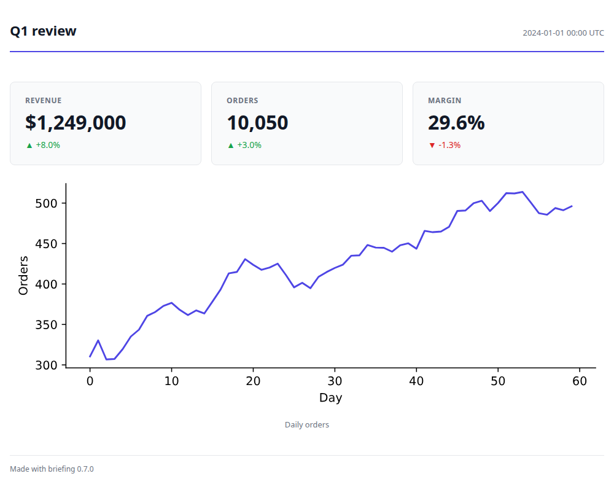
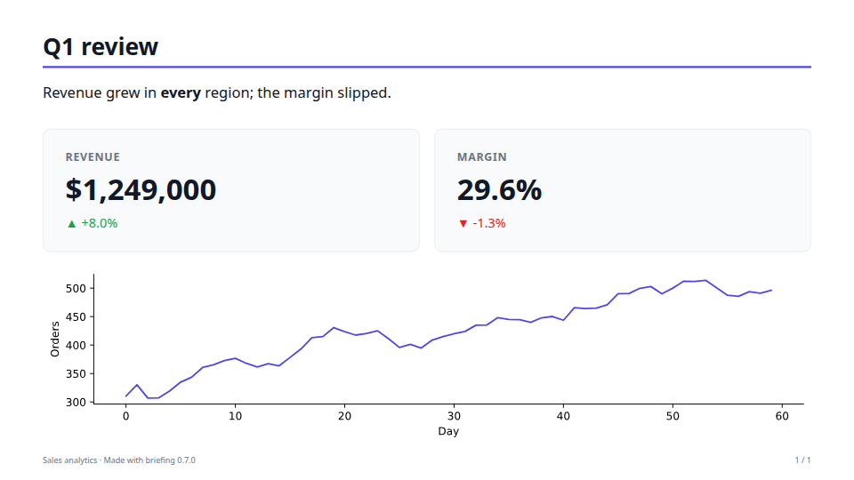
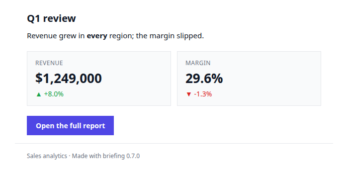

# briefing

**briefing** turns analysis into one self-contained HTML file, built from a small grammar of
blocks (text, numbers, charts, tables and layout) that people and coding agents both write.
The same blocks make a **report**, a **slide deck** or an **email digest**, and each one
works offline, forever: no CDN, no server, no account.

```bash
pip install briefing
```

```python
import briefing as bf

bf.save(
    [
        bf.Text("# Weekly sales"),
        bf.Group(bf.BigNumber("Revenue", 1.2e6, prev_value=1.1e6, format="${:,.0f}"),
                 bf.BigNumber("Orders", 8_421), columns=2),
    ],
    "sales.html",
)
```

## One grammar, three outputs

|  | Report | Slide deck | Email digest |
| --- | --- | --- | --- |
|  |  |  |  |
| **For** | Exploring and reference | Presenting, or sending round as a PDF | A short summary in the inbox |
| **Interactive** | Yes | Yes in the browser, as it shows in a PDF | No: mail apps run no script |
| **Made with** | `bf.Briefing` → `bf.save` | `bf.deck.Deck` → `bf.deck.save` | `bf.email.Digest` → `bf.email.to_message` |
| **Start here** | {doc}`quickstart` | {doc}`guides/decks` | {doc}`guides/email` |

{doc}`concepts` explains how the pieces fit: blocks, names and links, the theme, and the
three outputs.

## Find your way

- **Get started:** install, a first report, how briefing works, a report project.
- **Blocks:** every block, shared by the three outputs: text and numbers, tables, charts,
  images and files, banners, layout, links, and the lab's custom views.
- **Reports:** saving, the header and footer, size, printing and PDF, embedding, comparing runs.
- **Slide decks** and **email digests:** each output's own guide.
- **Ways to write it:** Markdown-first reports, notebooks, JSON, and coding agents.
- **Look:** themes, and colours and scales.
- **Examples** and the **API reference**.

```{toctree}
:caption: Get started
:maxdepth: 1
:hidden:

quickstart
concepts
guides/project
guides/datasets
```

```{toctree}
:caption: Blocks
:maxdepth: 1
:hidden:

guides/text
guides/tables
guides/charts
guides/assets
guides/banner
guides/layout
guides/links
guides/lab
```

```{toctree}
:caption: Reports
:maxdepth: 1
:hidden:

guides/reports
guides/export
guides/embed
guides/diff
```

```{toctree}
:caption: Slide decks
:maxdepth: 1
:hidden:

guides/decks
```

```{toctree}
:caption: Email digests
:maxdepth: 1
:hidden:

guides/email
```

```{toctree}
:caption: Ways to write it
:maxdepth: 1
:hidden:

guides/markdown
guides/notebooks
guides/json
guides/agents
guides/agent-prompt
```

```{toctree}
:caption: Look
:maxdepth: 1
:hidden:

guides/theming
guides/colours
```

```{toctree}
:caption: Examples
:maxdepth: 1
:hidden:

recipes
```

```{toctree}
:caption: API reference
:maxdepth: 1
:hidden:

api/blocks
api/layout
api/formatting
api/output
api/json
api/lab
api/datasets
```

```{toctree}
:caption: Project
:maxdepth: 1
:hidden:

changelog
GitHub <https://github.com/jeanmidevacc/briefing>
```
